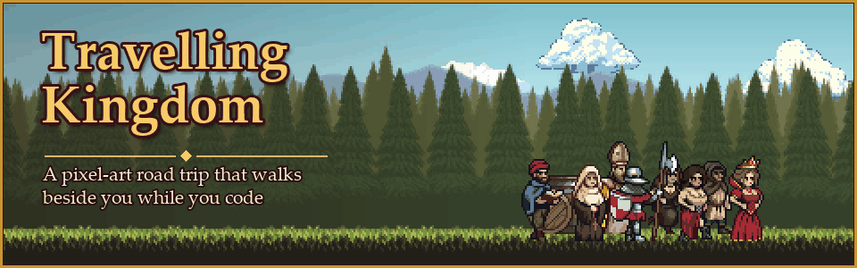
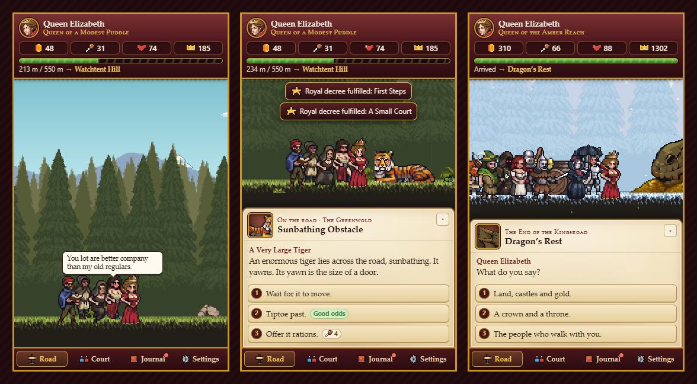
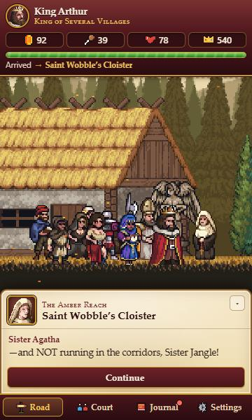
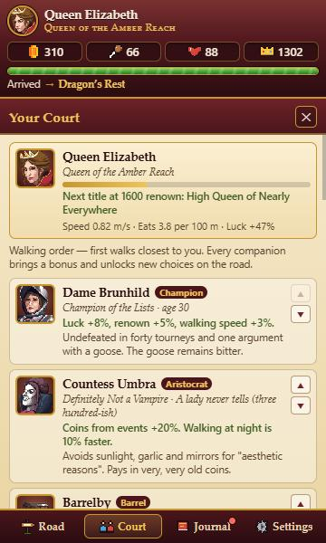
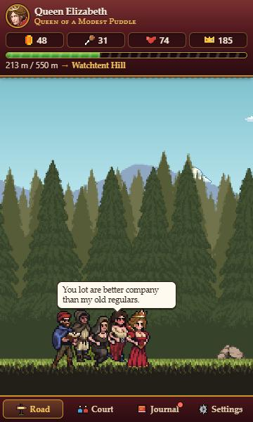

# Travelling Kingdom

<p align="center">
  
</p>

**A pixel-art road-trip RPG that walks beside you while you code.**

[](https://marketplace.visualstudio.com/items?itemName=MarySue.travelling-kingdom)
[](https://github.com/MarySueXLsD/VS-Extension-Travelling-Kingdom/releases/latest)

**New in 2.0 — The Kingsroad:** the whole game was rebuilt with 115 road events, 18 recruitable companions, a story with an ending, and a brand-new interface. See the [changelog](CHANGELOG.md).

Five years ago you bought a crown at an auction of *Miscellaneous Hats*. It is definitely real. Now a herald says that whoever wears a true crown to the Old Throne at Dragon’s Rest will rule the realm — so you set off down the Kingsroad with a scribe, a rented stable’s worth of confidence, and no idea what is waiting on the road.

Your kingdom is whoever walks with you.

## What’s inside

- **A living sidebar.** Your court walks the Kingsroad in the Explorer while you work: parallax forests, villages, campfires, rain and snow, and a day/night cycle that follows your clock.
- **115 road events in the spirit of *Keep Driving*.** Strangers, oddities and absurd dilemmas — a dog in a knight’s helmet who challenges you to a duel, a pirate three hundred miles inland, a tiger asleep across the road. Choices cost or reward coins, rations, morale and renown. Risky choices show their odds, and companions unlock answers nobody else can give.
- **18 companions to recruit.** A deserter scout, an orchard thief, a barkeep, a battle nun, a blacksmith, a retired cultist who glows in the dark, a definitely-not-a-vampire countess, and a barrel (nobody knows who is inside). Each brings a passive bonus, their own lines and their own options.
- **A story with an ending.** 17 stops across three regions — the Greenwold, the Amber Reach and the Frostmarch — each with its own local story, plus a pompous rival duke, a hopelessly lost wizard, a toad archmage and a dragon at the end of the road. After the coronation, the Royal Progress continues through endless procedurally named towns.
- **140+ lines of court chatter.** Speech bubbles that react to hunger, weather, nightfall and who is in your party.
- **Light, cosy resource play.** Coins, rations, morale and renown; markets, inns, odd jobs, foraging and shrines; 24 trinkets with permanent bonuses; titles that grow from *Self-Proclaimed Queen* to *Queen of the Realm*; 22 royal decrees to fulfil.
- **Polite to your work.** It only runs while the view is visible, never steals keyboard focus, defaults to 30 fps, makes no network requests and collects no telemetry.



<table>
  <tr>
    <td width="33%" valign="top"><br><sub><b>Every stop has a story.</b> Recruit Sister Agatha at Saint Wobble’s Cloister in the Amber Reach.</sub></td>
    <td width="33%" valign="top"><br><sub><b>Your court.</b> Every companion has a role, a trait and opinions. Reorder who walks closest to you.</sub></td>
    <td width="33%" valign="top"><br><sub><b>Company while you code.</b> Banter, weather and the occasional pigeon.</sub></td>
  </tr>
</table>

## Install

- **Marketplace:** search for **Travelling Kingdom** in the Extensions view, or open Quick Open (`Ctrl+P` / `Cmd+P`) and run `ext install MarySue.travelling-kingdom`.
- **From a release file:** download `travelling-kingdom-2.0.0.vsix` from the [latest release](https://github.com/MarySueXLsD/VS-Extension-Travelling-Kingdom/releases/latest), then in the Extensions view open the **…** menu and choose **Install from VSIX…**. This also works in Cursor and other VS Code–based editors.

Requires VS Code 1.85 or newer. Upgrading from 1.x keeps your hero, companions and progress.

## How to play

1. Open the **Explorer** and expand **Travelling Kingdom**, or run **Travelling Kingdom: Open the Kingsroad** from the Command Palette.
2. Choose a Queen or a King and a royal name. Your court starts walking on its own.
3. When a card appears, pick an answer with a click or the number keys (**1–4**, **Enter** to continue). Hide a card with **▾** — the court politely waits.
4. Click your hero to hurry the court along; click a companion to hear what they think.
5. At each stop, hear the local story, welcome a new companion, then visit the market, inn, odd jobs, foraging or shrine before moving on.
6. Keep the rations up: an empty larder slows everyone down and sours morale.

The status bar shows how far you are from the next stop (for example *42% → Puddleford*) and a bell when something on the road needs you. Click it to jump to the view.

## Settings

In-game **Settings**: road event frequency, court chatter, auto-decide when idle, distance units, time of day, weather, minimal background, minimal interface (follows your VS Code theme), reduce motion, frame rate, and reset.

VS Code settings:

| Setting | Default | Description |
| --- | --- | --- |
| `travellingKingdom.statusBar.enabled` | `true` | Show journey progress in the status bar. |
| `travellingKingdom.notifications.enabled` | `false` | Notify you when a road event needs you while the view is hidden. |

Commands: **Travelling Kingdom: Open the Kingsroad** and **Travelling Kingdom: Reset Progress…**

## Good to know

- **One journey, many windows.** Progress lives in VS Code’s global storage and is shared by every window. Only one window walks at a time; the others show *“Your court is travelling in another window”* with a button to take over.
- **Upgrading from 1.x.** Your hero, recruited companions, route progress and display settings carry over automatically into the new chronicle, and a short note welcomes you back.
- **Privacy.** No network requests, no telemetry, no accounts. Nothing leaves your machine.

## Development

```bash
npm install
npm run compile          # TypeScript → dist/
npm test                 # unit tests: rules, content integrity, saves, host
npm run test:integration # boots a real VS Code with a throwaway profile
npm run dev              # browser harness at http://localhost:5317
npm run package          # builds travelling-kingdom-<version>.vsix
npm run build:assets     # rebuilds static/ from the licensed art packs (needs the packs locally)
python tools/make-banner.py  # re-renders the animated README banner
```

Press **F5** in VS Code to launch an Extension Development Host.

| Path | Role |
| --- | --- |
| [`src/`](src/) | Extension host: view provider, saves, multi-window lease, status bar |
| [`media/index.html`](media/index.html) | Webview shell (shared by VS Code and the dev harness) |
| [`media/js/`](media/js/) | Game: rules (`logic.js`), world renderer, UI, orchestration |
| [`media/js/data/`](media/js/data/) | Content: companions, locations, story, events, banter |
| [`static/`](static/) | Generated sprite atlases, parallax layers and ground tiles |
| [`tools/build-assets.py`](tools/build-assets.py) | Builds the atlases from the licensed art packs (`npm run build:assets`) |
| [`tools/simulate.js`](tools/simulate.js) | Economy balance simulation over hundreds of playthroughs |
| [`test/`](test/) | Unit tests and the VS Code integration test |

## Credits

| Role | Name |
| --- | --- |
| Design and code | Viktar Syanau (MarySue) |
| Pixel art | [GandalfHardcore](https://gandalfhardcore.itch.io/) — characters, villages, backgrounds, props |
| Coins, gems and chests | ChestPack asset pack |

The art is used under its creators’ licences and may not be extracted or redistributed outside this extension.

**Publisher:** `MarySue` · **Support:** [GitHub issues](https://github.com/MarySueXLsD/VS-Extension-Travelling-Kingdom/issues)
