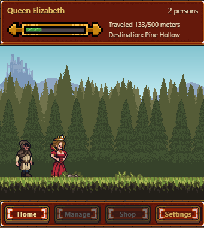
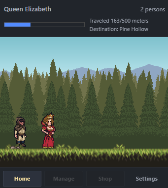
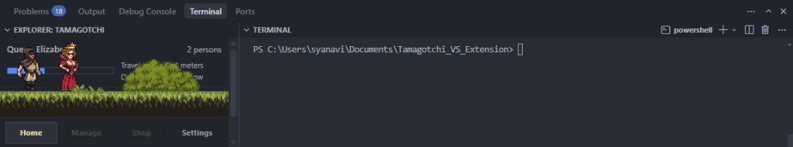
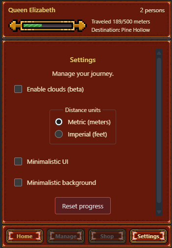

# Travelling Kingdom

A sidebar travel companion for **VS Code** and **Cursor**. Walk the road, visit destinations, recruit companions, and keep your character company while you work. Progress is saved in extension `globalState`.

**[Source on GitHub →](https://github.com/MarySueXLsD/vs_extension_travelling_kingdom)** · Latest package: **0.0.41**

## About

You are never alone in the Explorer panel. Your hero walks a scrolling pixel-art world toward the next landmark — meters tick up as the ground moves, camps appear on the road, and travelers can join your party along the way.

**What you'll do**

- **Travel the kingdom** — walk-in-place while the world scrolls; tap to boost speed
- **Reach destinations** — fill the meter, stop at landmarks (Soldier Camp and beyond), then Continue
- **Grow your party** — meet hooded travelers, recruit them, and keep them walking behind you
- **Tune the journey** — metric or imperial distance, minimal UI / background, optional clouds

**Features**

- Explorer webview with royal chrome (or minimalistic mode)
- Character select, persistent name / level / travel meters / party size
- Parallax scenery, ground tiles, roadside decor, and destination camps
- Recruit cutscene with scroll-based meet and live camera framing
- Settings panel and reset progress command

## Screenshots

<table>
  <tr>
    <td width="50%" valign="top">
      <strong>On the road</strong> — Queen and companion walking through pine country toward Pine Hollow.
        
      
    </td>
    <td width="50%" valign="top">
      <strong>Party of two</strong> — The hooded traveler follows behind the lead on the grassy path.
        
      
    </td>
  </tr>
  <tr>
    <td width="50%" valign="top">
      <strong>In the Explorer</strong> — Lives in the VS Code / Cursor sidebar next to your files.
        
      
    </td>
    <td width="50%" valign="top">
      <strong>Settings</strong> — Clouds, distance units, minimalistic UI / background, and reset.
        
      
    </td>
  </tr>
</table>

## Install from VSIX

1. Run `npm run package` (or download a release `.vsix` when published).
2. In Cursor / VS Code: **Extensions** → `...` → **Install from VSIX…**
3. Open **Explorer** and expand **Travelling Kingdom**.

If an older Tamagotchi-named build is installed, uninstall it first (extension ids changed with the rebrand).

## Run (development)

1. Open this folder in VS Code or Cursor
2. `npm install`
3. Press **F5** (Run Extension)
4. In the Extension Development Host, open **Explorer** → **Travelling Kingdom**

### Scripts

| Command | Role |
| --- | --- |
| `npm run compile` | TypeScript → `dist/` |
| `npm run watch` | Recompile on change |
| `npm run package` | Build `travelling-kingdom-<version>.vsix` |

### Project layout

| Path | Role |
| --- | --- |
| [`src/`](src/) | Extension host (`extension.ts`, state, webview provider) |
| [`media/`](media/) | Webview game (`game.js` / `main.js`), styles, icons |
| [`static/`](static/) | Characters, UI chrome, world art, `destinations.json` |
| [`docs/`](docs/) | Version history, Marketplace publisher form values |
| [`assets/`](assets/) | README screenshots |

### Documentation

- [Version history](docs/VERSION_HISTORY.md) — packaged build notes
- [Marketplace publisher](docs/MARKETPLACE_PUBLISHER.md) — Create Publisher form values

## Credits

| Role | Name |
| --- | --- |
| Designer / programmer | Viktar Syanau (MarySue) |

**Publisher ID:** `MarySue` · **Support:** abbigeilwf@outlook.com
